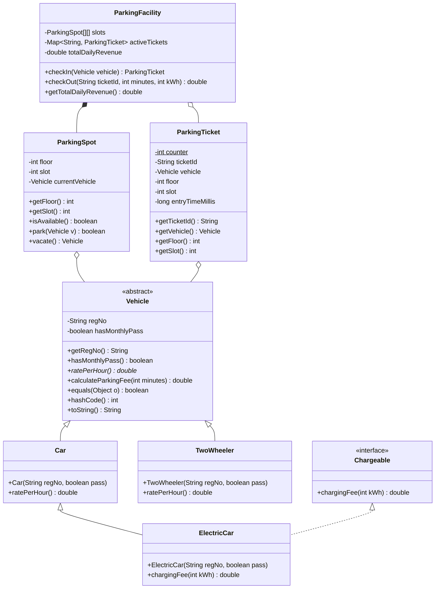
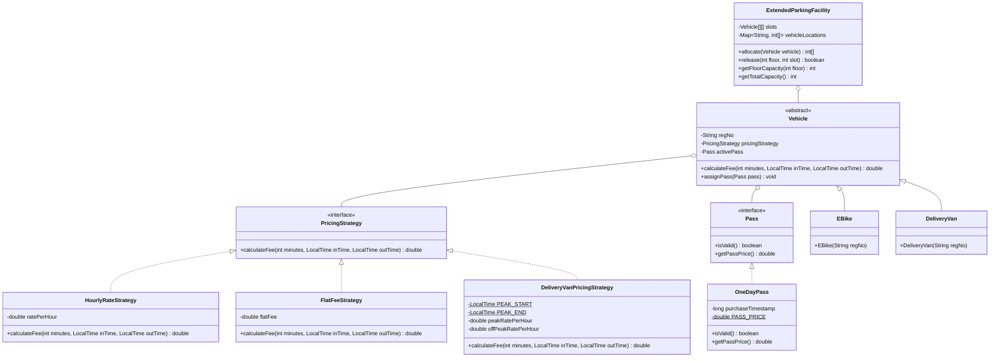
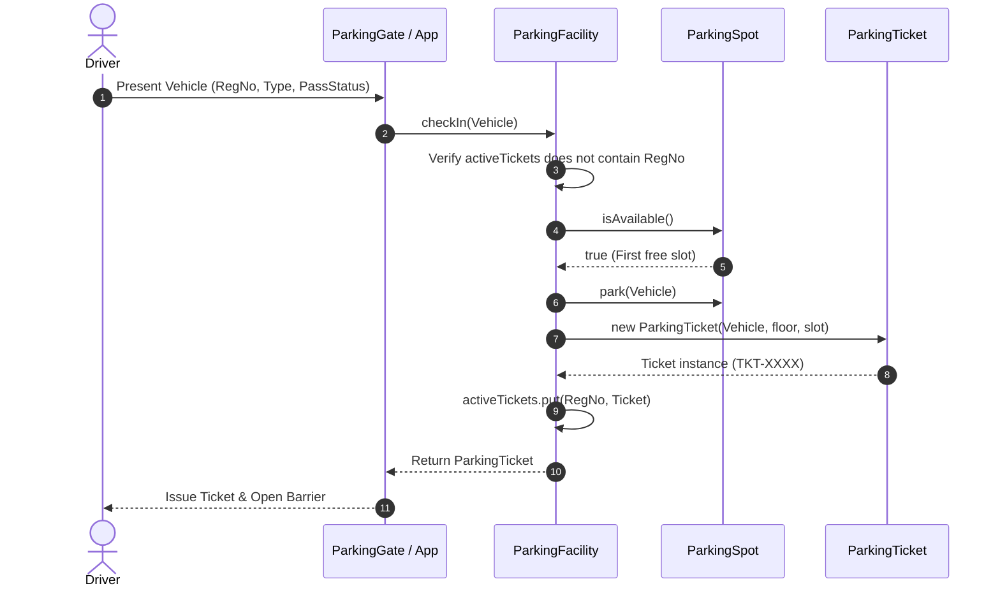

# Campus Smart-Parking System - UML Diagrams & Architectural Models

## 1. Core Domain Class Diagram (Tasks 01–11)

---

## 2. Adapted Day-4 Architecture Diagram (Task 12)

---

## 3. Vehicle Check-in & Allocation Sequence Diagram

